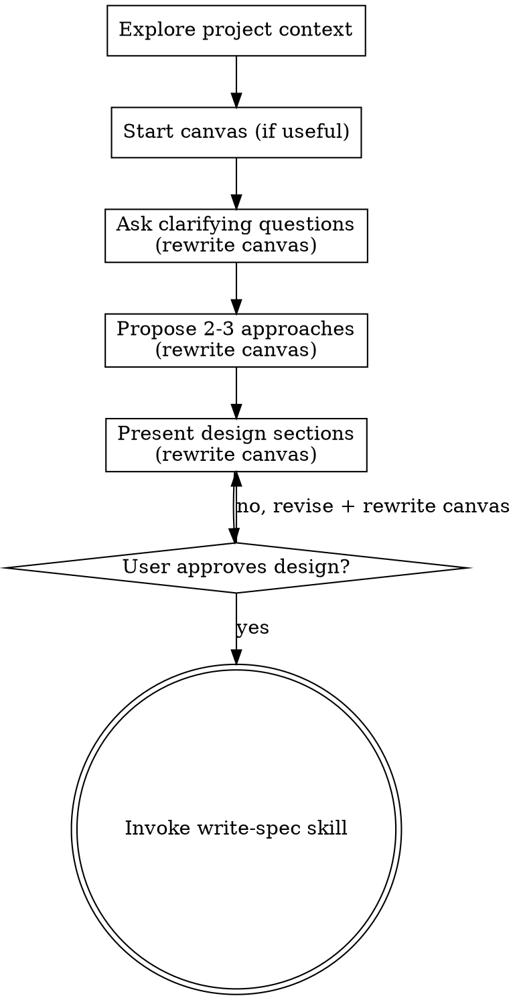

# Brainstorming Ideas Into Designs

Help turn ideas into fully formed designs and specs through natural collaborative dialogue.

Start by understanding the current project context, then ask questions one at a time to refine the idea. Once you understand what you're building, present the design and get user approval.

<HARD-GATE>
Do NOT invoke any implementation skill, write any code, scaffold any project, or take any implementation action until you have presented a design and the user has approved it. This applies to EVERY project regardless of perceived simplicity.
</HARD-GATE>

## Anti-Pattern: "This Is Too Simple To Need A Design"

Every project goes through this process. A todo list, a single-function utility, a config change — all of them. "Simple" projects are where unexamined assumptions cause the most wasted work. The design can be short (a few sentences for truly simple projects), but you MUST present it and get approval.

**Pipeline vs. local fix:** A short design conversation still applies here. The **write-spec → writing-plans** chain is for work large enough to need a written spec and plan — not for every approved design. writing-plans waits after a Lite or Full plan unless the user asked to execute. When the user asked for a small, pinned change ("fix this error", "rename X", "update this copy"), stop at design approval and implement; do not invoke write-spec unless they want a spec artifact.

## Checklist

You MUST create a task for each of these items and complete them in order:

1. **Explore project context** — check files, docs, design system, existing components, recent commits
2. **Start a Brainstorming Canvas when useful** — early, when the idea is more than a tiny pinned fix. Living map under `docs/playbook/canvases/`; rewrite it as the direction moves, and split into a step folder when the work has several steps built in order. Skip for obvious one-file fixes. See Brainstorming Canvas below.
3. **Ask clarifying questions** — one at a time, understand purpose/constraints/success criteria; **rewrite the canvas** when answers change the map
4. **Propose 2-3 approaches** — with trade-offs and your recommendation; record the chosen direction by collapsing candidates on the canvas
5. **Present design** — in sections scaled to their complexity, get user approval after each section; keep the canvas the consistent summary of what you have agreed. UI/layout choices as Markdown mockups on the canvas, grounded in the project's existing components and design language — not arbitrary external mockups.
6. **Transition to spec authorship** — mark the canvas approved and invoke write-spec; the canvas is the approved brainstorm summary the spec draws from (one spec at a time if the canvas spans several deliveries)

## Process Flow



**Terminal state is invoking write-spec** (or implementing directly for small approved changes). The canvas is the thinking document the user approved; the spec is the contract for the planning agent, distilled from the canvas — one spec at a time when the canvas is large.

## The Process

**Understanding the idea:**

- Check out the current project state first (files, docs, recent commits)
- Before asking detailed questions, assess scope: if the request describes multiple independent subsystems (e.g., "build a platform with chat, file storage, billing, and analytics"), flag this immediately. Don't spend questions refining details of a project that needs to be decomposed first.
- When the idea is worth a real design conversation (not a typo/rename), **start a Brainstorming Canvas early** — see below. Use it as the collaborative map so the current direction stays visible while you explore.
- For appropriately-scoped projects, ask questions one at a time to refine the idea
- Prefer multiple choice questions when possible, but open-ended is fine too
- Only one question per message - if a topic needs more exploration, break it into multiple questions
- Focus on understanding: purpose, constraints, success criteria
- When the conversation settles or revises something, **rewrite the canvas** in the same turn so chat drift does not outrun the map
- **Discussing is not building, and thinking out loud is not an edit order.** An opinion ("I think we should merge these"), a question, or a pick between your options ("B, but keep X in mind") is answered in chat. It does not start implementation, and it does not write your own proposal onto the canvas as if it were agreed. Write to the canvas what the user has settled or asked you to write, and build only after an explicit go ("build it", approval of the design). If you are unsure whether they decided or are still thinking, say what you would change and ask. The exception is a direct implementation request ("add that now", "ja mach das"): that is the approval, do not hold it behind a second confirmation.

**Language and requirement fidelity:**

- Treat spoken, mixed-language, typo-filled input as compressed intent. Normalize it internally without changing its meaning, then state the interpreted outcome in the user's language before choosing a design.
- Separate required behavior, optional suggestions, examples, preserved behavior, and open questions. Do not turn words such as "maybe", "could", or "what do you think?" into a committed design without marking the choice.
- If the wording supports materially different implementations, ask one focused question. If the user says "not what I meant", "where is it", "still there", "again", or an equivalent, stop defending the interpretation, compare the request with the delivered behavior, and rewrite the contract.
- **REQUIRED COMMUNICATION CHECK:** Apply `german` to German wording and `unslop` to user-facing output when those skills are available. Keep the user's natural tone without copying typos or turning it into corporate language.

**Exploring approaches:**

- Propose 2-3 different approaches with trade-offs
- Present options conversationally with your recommendation and reasoning
- Lead with your recommended option and explain why
- Record the chosen approach on the canvas and collapse the candidate list. Rejected alternatives stay as one line each — do not leave the old list sitting next to a preferred direction

**Presenting the design:**

- Once you believe you understand what you're building, present the design
- Scale each section to its complexity: a few sentences if straightforward, up to 200-300 words if nuanced
- Ask after each section whether it looks right so far
- Cover: architecture, components, data flow, error handling, testing
- Be ready to go back and clarify if something doesn't make sense
- The canvas should already reflect approved sections; treat mismatches as a signal to rewrite the canvas before moving on

**UI and visual choices — project context, not arbitrary design:**

- Ground every layout or interaction choice in this project's existing shell, components, tokens, and patterns (read design-language / frontend docs and reuse pointers first).
- Prefer **Markdown mockups on the canvas** (structure, hierarchy, copy, which existing controls) while brainstorming. That keeps the conversation about *this* product, not a generic wireframe.
- Do not invent a parallel visual system or design in a disconnected companion UI. Discuss choices against real components the app already has.
- In-app / route-level mock pages come later only when useful — typically during or after the spec, when committing to a real surface makes the choice clearer. Brainstorm first on the canvas.

Before implementation, turn approved UI intent into a compact contract. Record the observable requirement, its consumer or surface, and what must remain unchanged:

| Requirement | Observable check | Consumer or surface | Preserve |
|-------------|------------------|--------------------|----------|
| visible control, copy, state, or motion | present, absent, enabled, disabled, ordered, or timed | route, component, locale, viewport, or build target | neighboring controls, labels, and unrelated states |

Use the matrix for both positive and negative assertions. A shared change is not closed while one relevant consumer still shows the old result, unless the matrix explicitly marks that consumer as intentionally different. If a user reports a missing control or stale copy after implementation, reopen the design and inspect the actual render path instead of treating the report as a new preference.

**Design for isolation and clarity:**

- Break the system into smaller units that each have one clear purpose, communicate through well-defined interfaces, and can be understood and tested independently
- For each unit, you should be able to answer: what does it do, how do you use it, and what does it depend on?
- Can someone understand what a unit does without reading its internals? Can you change the internals without breaking consumers? If not, the boundaries need work.
- Smaller, well-bounded units are also easier for you to work with - you reason better about code you can hold in context at once, and your edits are more reliable when files are focused. When a file grows large, that's often a signal that it's doing too much.

**Working in existing codebases:**

- Explore the current structure before proposing changes. Follow existing patterns.
- Where existing code has problems that affect the work (e.g., a file that's grown too large, unclear boundaries, tangled responsibilities), include targeted improvements as part of the design - the way a good developer improves code they're working in.
- Don't propose unrelated refactoring. Stay focused on what serves the current goal.

## Brainstorming Canvas

A **canvas** is the collaborative map of the brainstorm — started near the beginning of the conversation, rewritten as you go, and used as the summarized basis for write-spec. It shows what you are forming together: the current direction, what is still open, and briefly what you set aside. It replaces any separate visual-companion workflow: mockups and design choices live here in Markdown, in this project's vocabulary. It is a **temporary playbook artifact**, not canonical product documentation. Durable behavior lands in `docs/knowledge/` (via docdriven) after implementation; then clean up leftovers (see Lifecycle).

**Start a canvas early when** the user's idea needs a design conversation that could drift — a feature, flow, multi-step capability, or anything where keeping a written vision consistent matters. Skip for tiny pinned fixes ("rename X", "fix this typo") where you will implement directly after a short approval.

**Path and structure** (user preference for location overrides this default):

- **Single canvas (default):** `docs/playbook/canvases/<topic>.md` — lowercase kebab-case topic name, no `YYYY-MM-DD-` date prefix, and no `-canvas` suffix (`docs/playbook/canvases/photo-agent.md`). Do not create a subfolder for a single file.
  - A single canvas that tracks one strand of work (`batch1-enrichment.md`, not one canvas per source) passes the same test as a step: it names its end ("batch 1 enriched in the ground truth, supplier packages rebuilt"), holds open work only, and links numbers and rules. When the strand grows several steps, it becomes a step folder. A canvas named after one source or topic, with no end, is the anti-pattern.
- **Step folder (when the work has several steps built in order):** `docs/playbook/canvases/<topic>/` where the folder carries the topic name in lowercase kebab-case and the files inside are numbered in two-digit build order with underscores:
  ```text
  docs/playbook/canvases/<topic>/
    00_overview.md
    01_<first_step>.md
    02_<second_step>.md
  ```
  - **Cut by work steps, never by topic or chapter.** Test every file: *can this file be finished?* A step finishes when it is built, deferred, or dropped (see Step exits). A file that cannot finish is a chapter. Its content belongs to the knowledge owner from the start, and the canvas only links it. A file that mixes both is split: the chapter part goes to the owner, the step stays.
  - **Anti-pattern:** `data-prep/requirements.md`, `measurements.md`, `columns.md`, `outlook.md`, `invoices.md`. Requirements, measurements, and column rules are never "built", so these files never leave, and they turn into a second copy of their owners. Step cut instead: `data-prep/00_overview.md`, `01_invoice_extraction.md`, `02_batch_rebuild.md`, with requirements and measurements linked from their owners.
  - `00_overview.md` is always the entry point: the overarching question, current overall status, a compact table mapping each open step (`01_...`, `02_...`) to its scope and when it runs, and one line per closed step (see Step exits).
  - Detailed design, open questions, and mockups for a step live only in its numbered file (`01_...`, `02_...`), never duplicated in `00_overview.md`.
  - Child filenames do not repeat the folder's topic name (`kpi-validation/01_data_completeness.md`, not `kpi-validation/01_kpi_data_completeness.md`).
  - If a numbered step itself grows large enough to need a subfolder, name the subfolder `NN_<step>/` and start inside with `00_overview.md`, `01_...`.

**Header every canvas starts with:**

```markdown
# <Topic> — Brainstorming Canvas

> **Main question:** <what the user wants to reach, in their words, one sentence>
>
> **Status:** Brainstorming | Approved — basis for specs | Implementing | Leftover — ready to delete
>
> Living map of this brainstorm. Rewrite it when the direction changes.
> Specs and plans are distilled from this file. Not canonical product behavior —
> after shipping, knowledge docs own shipped truth; leftovers hold remaining
> work only, then delete when nothing remains.
```

Every canvas file carries this header, step files included. There is no "Deferred" status: a deferred step leaves the canvas as a decision doc (see Step exits).

If the `visual-markdown` skill is available, load it before writing a canvas and use its blocks for work steps, decisions and questions. The status then goes into `visual.status` in the front matter, which shows it in the band at the top, and the header drops its `**Status:**` line so the page does not show the status twice. The main question and the explanation stay.

**Numbers and measurements never live on a canvas.** Counts, rates, and result tables stay in the finding or knowledge doc that produced them; the canvas links it. A copied table goes stale the next time the analysis runs.

Write free-form sections that fit the conversation (promise, principles, journey, Markdown UI mockups, decisions, not-now, open questions). No fixed section list beyond the status header. Add ideas freely, then **fold them in**. Reshape the document as you clarify; rewrite so it stays a current map rather than a log of every conversational beat. UI mockups name existing project components and patterns where possible.

**During brainstorming:** the canvas is a living map, not a transcript and not yet the fixed vision. If chat strays or the user revises something, rewrite the canvas in the same turn before treating the new idea as settled. A reader should see the current direction, what is still open, and (briefly) what you set aside.

When the conversation moves:
- A chosen direction **replaces** the candidate list. Rejected alternatives stay as one line each.
- An answered question **leaves** Open questions.
- A new framing **rewrites** the old problem statement. Do not leave both.
- Unresolved conflicts stay visible as tensions or open questions. That is useful. Two competing essays are not.

**Every canvas update, in this order:**

1. Read the whole canvas, not only the section you came to change.
2. Hold the update against the main question in the header. A sub-question the user raises, even one they stress ("check first whether X is good enough"), gets its own section under the current direction. It does not take over the title, the lead section, or the main question. Only the user changes the main question; when their message sounds like they did, ask in one line.
3. Put each new point into the section that already owns its topic. Open a new section only for a topic the canvas does not cover yet.
4. Settle what the conversation settled. A proposal is settled when the user agrees, or when their next message only makes sense if it stands ("and boxplots too?" after you proposed charts). Move it to the agreed direction, drop its "proposal" label, and delete the open question that asked for it. When you cannot tell, ask in one line in chat; do not leave the label as a placeholder.
5. Remove what the turn replaced from every place it appears: tables, lists, examples, open questions. When one thing merges into another, the old name survives only as one line under set aside.
6. Read the result top to bottom as someone who missed the chat. Each topic appears once, with one current state, and no label contradicts the conversation. The first section still answers the main question.

When more than one section changes, write the whole file in one pass instead of patching section by section.

Structure when a direction starts to form: lead with the current vision, then open questions, then not-now. Early on, loose notes are fine. Prefer short, clear prose. Keep the nouns.

**When design is approved:** the map is now the basis for specs. Stop exploring on it; rewrite only to keep remaining work accurate.

1. Mark canvas status **Approved — basis for specs**.
2. If the canvas covers several work steps and is still a single file, split it into `docs/playbook/canvases/<topic>/00_overview.md` plus `01_<step>.md`, `02_<step>.md` in build order so each step has its own focused file. A single file over ~1,500 words that is still one step holds chapter material: move settled rules to their owner and link them.
3. Invoke write-spec for the **current** slice. Pass `**Canvas:** docs/playbook/canvases/<topic>.md` (or `docs/playbook/canvases/<topic>/NN_<step>.md` for a step folder). write-spec authors one spec distilled from that slice (reading `00_overview.md` only for framing), not the whole folder as one mega-spec.
4. Later work distills from its own step file + shipped knowledge — do not paste the whole canvas into every spec.

**Lifecycle (playbook is temporary):**

| Artifact | During work | After ship + docdriven |
|----------|-------------|-------------------------|
| Canvas | Living map → basis for specs | Close each finished step by its exit (Step exits below), with or without a spec or plan. **Delete** the canvas, or the whole folder, when no step is open. **Ask** only if ownership is unclear. |
| Spec / plan | Working files for a slice | **Delete** the plan. **Delete** the spec when the slice is complete and no open spec still Depends on that file; otherwise **strip** shipped units. **Ask** only when Depends-on or unfinished slices make ownership unclear. |

Knowledge docs own shipped truth. Specs and canvases may only hold remaining work — strip shipped content, do not annotate it as history. Never treat `docs/playbook/**` as the long-term source of truth for product behavior.

**Step exits.** Every step (a numbered file, or one slice of a single canvas) ends in exactly one of four ways. Apply the exit the moment the step ends: at the end of a plan, after a direct implementation, or when a data analysis or a decision settles it without any spec or plan.

| Exit | What goes to knowledge | What happens on the canvas |
|------|------------------------|----------------------------|
| **Built** | Behavior and rules, to the owning knowledge doc (via docdriven) | Delete the step file; one line in `00_overview.md` linking the owner |
| **Deferred** | The decision with its reason, plus the draft, as a `type: decision` doc at the owner with `status: deferred` and a `revisitWhen` trigger (docdriven knowledge schema) | Delete the step file; one line in `00_overview.md` linking the decision doc |
| **Dropped** | Nothing | Delete the step file; one sentence in `00_overview.md` saying why |
| **Open** | Nothing yet | Stays |

Keep the numbers of remaining steps unchanged (`02_...` stays `02_...` so links do not break). When no step is open, delete the folder or the single canvas.

## After the Design

**The mechanism you reasoned through belongs on the canvas, not just in the transcript.** When the conversation settled on a rule, named units, or a mechanism, fold them into the current direction on the canvas, including what *kind* of thing each unit is and which area owns it. If you also agreed fields, types, asset names, or relationships, include those; if not, leave them out. Anything that exists only in the chat is lost.

Do not invent source paths or code. Keep product names the conversation settled (assets, types, screens, fields, commands). The spec keeps those names; the plan adds source locations.

**Size** is your read on how much spec the work needs — write-spec confirms it. **S means no spec at all:** stop at design approval and implement. After implementing, close the step by its exit (Step exits) and delete the canvas when no step is open. Do this even when there was no spec or plan — a fully implemented canvas is leftover. **Plan tier** is the expected writing-plans tier — Lite for one cohesive capability even across runtimes; Full only when packages could be reviewed independently. Note both on the canvas when you mark it approved.

**Transition to write-spec** (substantive features only):

- Invoke write-spec — it writes the spec from the canvas, runs review, and continues to writing-plans. Canvas approval is the user gate. Do not wait for the user to approve the spec. writing-plans then waits with an execute prompt unless they asked to execute after the plan.
- Do NOT invoke writing-plans directly; write-spec continues into it after the spec review pass
- For small approved changes, skip write-spec and implement directly. Then close the step by its exit (Step exits) and delete the canvas when no step is open.

## Key Principles

- **Canvas is a map, not a log** - Rewrite the current direction; do not append a section per beat
- **One question at a time** - Don't overwhelm with multiple questions
- **Multiple choice preferred** - Easier to answer than open-ended when possible
- **YAGNI ruthlessly** - Remove unnecessary features from all designs
- **Explore alternatives** - Always propose 2-3 approaches before settling
- **Incremental validation** - Present design, get approval before moving on
- **Be flexible** - Go back and clarify when something doesn't make sense
- **Design in project context** - Canvas Markdown mockups using this app's components; no arbitrary external companion UI
