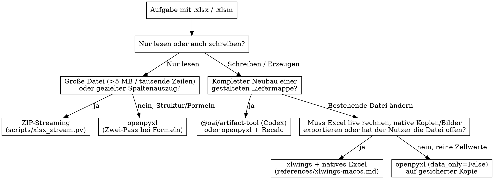

# Excel Workflow

Dieser Skill regelt projektübergreifend, wie Arbeitsmappen (`.xlsx`, `.xlsm`) gelesen, geprüft, geändert und neu erzeugt werden. Wenn ein Projekt einen eigenen Excel- oder Dokumentations-Skill besitzt, definiert dieser nur die fachlichen Felder, Dateipfade, Schlüsselfelder und expliziten Ausnahmefreigaben des Projekts und verweist für Technik und Sicherheitsregeln hierher.

## 1. Den passenden Weg wählen

Nicht jede Aufgabe mit `openpyxl` oder `pandas` erschlagen. Vor dem ersten Zugriff anhand von Dateigröße, Formeln und offenem Desktop-Excel entscheiden:



| Fall | Werkzeug | Warum und wie |
| --- | --- | --- |
| **Große Dateien lesen oder ausgewählte Spalten extrahieren** | [scripts/xlsx_stream.py](scripts/xlsx_stream.py) | Liest `xl/workbook.xml`, `xl/sharedStrings.xml` und das Zielblatt in 4-MB-Chunks direkt aus dem ZIP-Archiv (`sheets`, `headers`, `stream`, `inputs`). Verbraucht kaum RAM, ist um Größenordnungen schneller als `openpyxl` und prüft vorher/nachher `(st_size, st_mtime_ns)` auf Unverändertheit der Quelle. |
| **Struktur, Formeln, Validierungen und Werte ohne laufendes Excel prüfen** | `openpyxl` (`data_only=False` und `data_only=True`) oder OOXML-Prüfung | Zwei Ladevorgänge nutzen: `data_only=False` für Formeln, `data_only=True` für gecachte Werte. **Niemals eine mit `data_only=True` geöffnete Mappe speichern**, da sonst alle Formeln gelöscht werden. Siehe [builders-and-ooxml.md](references/builders-and-ooxml.md). |
| **Neue Liefer- oder Review-Arbeitsmappe mit Tabellen, Formeln und Vorschau erzeugen** | `@oai/artifact-tool` (in der Codex-Laufzeit) oder `openpyxl` mit anschließendem Recalc | `@oai/artifact-tool` berechnet Formeln über `wb.recalculate()` und rendert PNGs über `wb.render()`. Relative Hyperlinks danach per OOXML ergänzen und `${target}.inspect.ndjson` löschen. Siehe [builders-and-ooxml.md](references/builders-and-ooxml.md). |
| **Bestehende Mappe mit Live-Formeln, Dashboard, nativen Zeilenkopien oder bei geöffnetem Excel ändern** | `xlwings` und Microsoft Excel | Auf macOS über Launch Services (`open -g` bzw. ausgeblendet `open -g -j`) öffnen, nur betroffene Blätter berechnen und Zwischenablage bei `copy()` / `copy_picture()` schützen. Siehe [xlwings-macos.md](references/xlwings-macos.md). |

## 2. Fünf Pflichtregeln vor, während und nach dem Schreiben

**Ein Verstoß gegen den Wortlaut dieser Regeln ist ein Verstoß gegen ihren Sinn.** Auch unter Zeitdruck keinen dieser Schritte überspringen.

### Regel 1: Offene Dateien, Sperren und `Saved`-Zustand vorab prüfen
* Vor jedem Schreib- oder Rebuild-Auftrag prüfen, ob eine Sperrdatei `~$<Dateiname>.xlsx` existiert und ob Microsoft Excel läuft.
* Läuft Excel, über `Path(book.fullname).resolve() == target.resolve()` prüfen, ob die Zieldatei in genau dieser einen Instanz offen ist. Mehrere Excel-Instanzen, eine mehrfach geöffnete Datei, Schreibschutz (`read_only`) oder eine `~$`-Sperrdatei ohne zugeordnetes offenes Workbook in dieser Instanz stoppen den Lauf sofort. Niemals eine `~$`-Sperrdatei löschen.
* Ist die Zieldatei in Excel offen und hat ungespeicherte Änderungen (`saved == False`), sofort anhalten und den Zustand erhalten. Niemals einfach `book.save()` aufrufen, um ungespeicherte Änderungen des Nutzers ungeprüft mitzuspeichern, und niemals den `Saved`-Schalter manuell umlegen. Ausnahme ist nur eine im Projekt-Skill ausdrücklich dokumentierte Schließfreigabe für feste Projektdateien.
* Andere offene Arbeitsmappen des Nutzers bleiben unangetastet offen. Globale Excel-Einstellungen wie `app.calculation` niemals für eine Probe umstellen, wenn Nutzermappen offen sind.

### Regel 2: Original nie ohne Sicherung überschreiben und bei Risiko erst proben
* Vor jeder Änderung am Original eine unveränderte Sicherungskopie anlegen und per SHA-256 bestätigen (`sha256(backup) == sha256(source)`).
* Ist die Zieldatei bereits in Excel geöffnet oder ändert der Auftrag Struktur, Spalten, Zeilenbestand oder Formatierungsregeln, wird die Änderung zuerst auf einer Wegwerfkopie (`DISPOSABLE-...xlsx`) erprobt und geprüft.
* Bei einem Neubau wird die Datei zuerst in einem Staging-Verzeichnis erzeugt und geprüft. Erst wenn alle Prüfungen bestanden sind und sich weder der SHA-256-Hash der Eingabedaten noch der Hash der Zieldatei seit Laufbeginn verändert hat, wird die fertige Datei auf den Zielpfad kopiert.
* Schlägt ein Schritt fehl, bleiben Original, Sicherung, Probe und Fehlerbericht für die Diagnose erhalten. Keinen ungeprüften Rollback durchführen und keinen Erfolg melden.

### Regel 3: Formeln, Struktur und manuelle Reviewspalten erhalten
* Zum schnellen Prüfen von Blättern, Kopfzeilen, großen Spaltenauszügen und bestehenden manuellen Eingaben (Dropdowns, Status, Notizen) direkt `scripts/xlsx_stream.py` auf der `.xlsx`-Datei nutzen (oder `iter_selected_rows` / `read_keyed_inputs` in Python importieren):
  ```bash
  # Blätter und Kopfzeile prüfen
  python3 -I <pfad-zum-skill>/scripts/xlsx_stream.py sheets workbook.xlsx
  python3 -I <pfad-zum-skill>/scripts/xlsx_stream.py headers workbook.xlsx --sheet "Raw data" --header-row 3

  # Ausgewählte Spalten einer großen Datei als NDJSON streamen
  python3 -I <pfad-zum-skill>/scripts/xlsx_stream.py stream workbook.xlsx --sheet "Raw data" --header-row 3 --cols '{"C":"code","I":"description","P":"spend"}'

  # Manuelle Reviewspalten vor einem Rebuild anhand eines stabilen Schlüssels sichern
  python3 -I <pfad-zum-skill>/scripts/xlsx_stream.py inputs workbook.xlsx --sheet "Sheet1" --key "Supplier Number" --fields "Review Status,Approval,Notes" --header-row 7
  ```
* Niemals vorbereitete JSON- oder CSV-Stände als alleinige Quelle nehmen, wenn das Workbook seitdem manuell bearbeitet worden sein kann.
* Bestehende Formeln, ausgeblendete Hilfsspalten, Datenvalidierungen (`dataValidation`), bedingte Formatierungen, Tabellenbereiche (`tableParts`) und Hyperlinks erhalten. Keine Formelzellen durch berechnete Festwerte überschreiben.

### Regel 4: Nach dem Schreiben Zeilenzahl, Summen und Live-Reaktion abgleichen
* **Zeilenzahl und Schlüssel:** Prüfen, dass die Anzahl der Datensätze und die Menge der eindeutigen Schlüssel mit der Quelle übereinstimmen und alle nicht geänderten Felder pro Schlüssel unverändert geblieben sind.
* **Summen und Kennzahlen:** Berechnete Summenzellen in Tabellen und auf Overview- oder Dashboard-Blättern gegen die unabhängig aus den Quelldaten berechnete Summe abgleichen.
* **Formel-Fehler:** Gesamte Mappe nach der Neuberechnung auf `#REF!`, `#DIV/0!`, `#VALUE!`, `#NAME?`, `#N/A`, `#NUM!`, `#NULL!`, `#SPILL!` und `#CALC!` prüfen.
* **Live-Formel-Probe bei neuen oder umgebauten Formeln:** Eine Eingabezelle (etwa einen Betrag oder ein Review-Dropdown) probeweise ändern, neu berechnen, prüfen, dass sich abhängige Summen und `COUNTIF`/`SUMIFS`-Zähler um genau den erwarteten Wert bewegen, den Originalwert wiederherstellen, erneut berechnen und die exakte Wiederherstellung bestätigen.

### Regel 5: Ergebnis per Vorschau oder erneutem Lesen prüfen und ehrlich berichten
* Nach dem Speichern das Ergebnis durch erneutes Einlesen der gespeicherten Datei und, wo eine Render- oder Excel-Umgebung verfügbar ist, über PNG-Vorschauen der betroffenen Bereiche (`wb.render()` oder `Range.copy_picture()`) prüfen.
* In den Vorschauen auf abgeschnittenen Text, Zeilenhöhen, Spaltenbreiten, Zahlen- und Datumsformate, Statusfarben und versehentliche Durchstreichungen (aus Excels manuellem Berechnungsmodus) achten.
* **Bildexport ist nicht gleich Bildprüfung:** Im Bericht klar trennen, ob Bilder nur erzeugt oder tatsächlich vom Agenten gelesen und visuell kontrolliert wurden.
* **Nur bestandene Prüfungen melden:** Konnte eine Prüfung mangels laufendem Excel oder fehlender Vorschau nicht durchgeführt werden, diese Grenze im Abschlussbericht ausdrücklich offen benennen.

## 3. Häufige Ausreden und rote Linien

| Ausrede | Realität |
| --- | --- |
| „Ich nehme für die 90-MB-Datei schnell `pandas.read_excel` oder `openpyxl` im `read_only`-Modus.“ | `openpyxl` parst trotzdem jede Zelle bis zur Zielspalte als Python-Objekt, und Zusatz-Engines wie `calamine` fehlen oft. `scripts/xlsx_stream.py` liest nur die gewünschten Spalten per Byte-Regex in Sekunden und prüft `st_mtime_ns`. |
| „Die Datei ist in Excel offen (`~$...`), ich verbinde mich per `xlwings`, schreibe die Zelle und rufe `wb.save()` auf.“ | Wenn der Nutzer ungespeicherte Änderungen in der Mappe hat, speichert `wb.save()` diese ungeprüft mit oder überschreibt seinen Stand. Erst `book.api.saved.get()` und Live-Werte gegen das Backup prüfen; bei bereits offener Datei auf einer Kopie proben. |
| „Ich rufe kurz `wb.app.calculate()` auf, damit das Dashboard stimmt.“ | `app.calculate()` berechnet alle offenen Nutzermappen in Excel und markiert fremde Mappen als ungespeichert. Immer nur die Zielblätter über `book.app.api.calculate(sheet.used_range.api)` berechnen. |
| „Ich schreibe die Werte direkt mit `openpyxl` in die Zieldatei zurück, das geht am schnellsten.“ | `openpyxl` löscht beim Speichern alle gecachten Formelwerte. Wer die Datei in einer Vorschau oder mit `data_only=True` öffnet, sieht überall `None`, bis neu berechnet wurde. |
| „Die PNG-Vorschauen wurden ohne Fehler exportiert, also passt das Layout.“ | Ein erfolgreicher Export heißt nur, dass eine Datei geschrieben wurde. Erst wenn du das Bild gelesen und auf Textabschnitt, Farben und Zahlenformate geprüft hast, ist die Sichtprüfung abgeschlossen. |

**Rote Linien (Sofort stoppen):**
* `load_workbook(..., data_only=True)` gefolgt von `.save()`
* Löschen einer `~$`-Sperrdatei oder Überschreiben einer Datei, während eine nicht zugeordnete Sperre existiert
* Direktes Überschreiben einer Zieldatei ohne vorherige Sicherung und Hash-Prüfung
* Rebuild einer Review-Arbeitsmappe ohne vorheriges Auslesen der bestehenden manuellen Eingabespalten aus der Zieldatei
* Globales Umstellen von `app.calculation` in einer Excel-Instanz mit offenen Nutzermappen

## 4. Zusammenspiel mit Projekt-Skills

Ein Projekt-Skill (etwa `project-excel` oder der Excel-Abschnitt in einem Projekt-DocDriven-Skill) wiederholt diese Grundregeln nicht, sondern verweist am Anfang auf `excel-workflow` und regelt nur:
1. Feste Dateipfade, virtuelle Umgebungen und vorhandene Projekt-CLIs (wie `tracker_edit.py` oder Build-Skripte).
2. Tabellenstruktur, Pflichtfelder, Datums- und Statuskonventionen sowie die stabilen Schlüssel für manuelle Reviewspalten.
3. Ausdrücklich vom Nutzer erteilte Ausnahmefreigaben für bestimmte Projektdateien (zum Beispiel das Schließen fester Tracker ohne Rückfrage).
